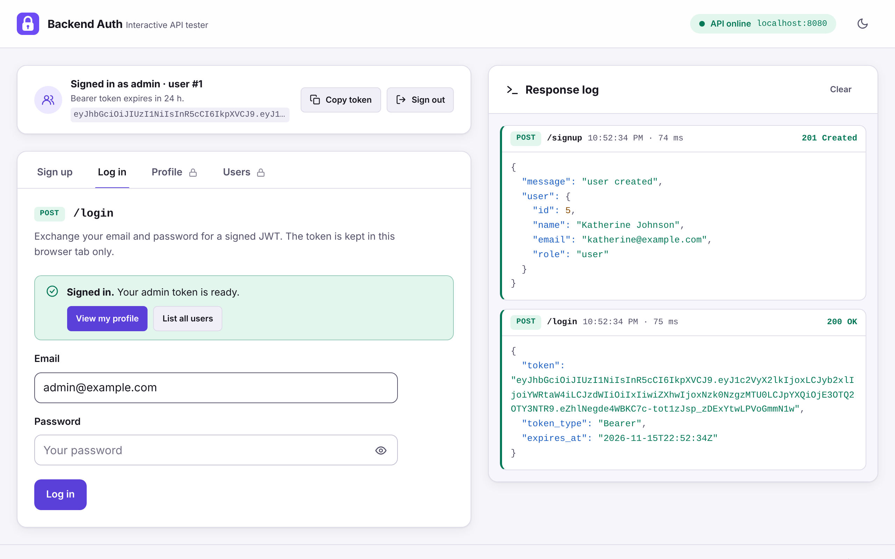
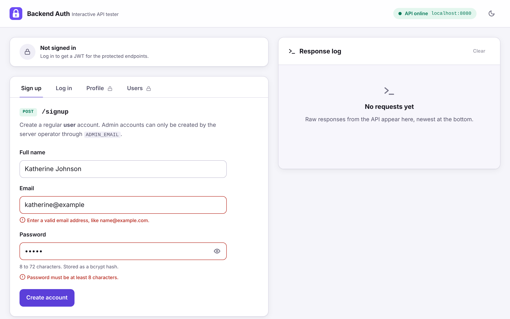
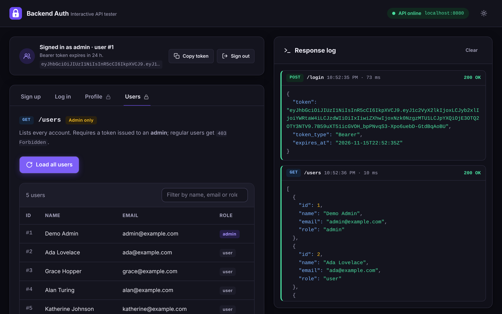
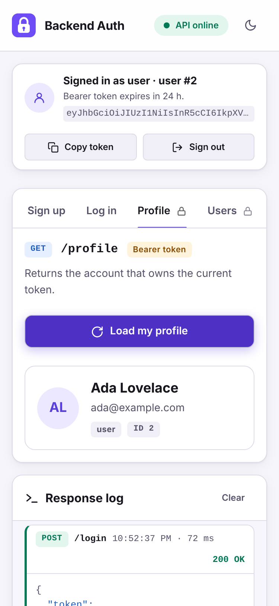
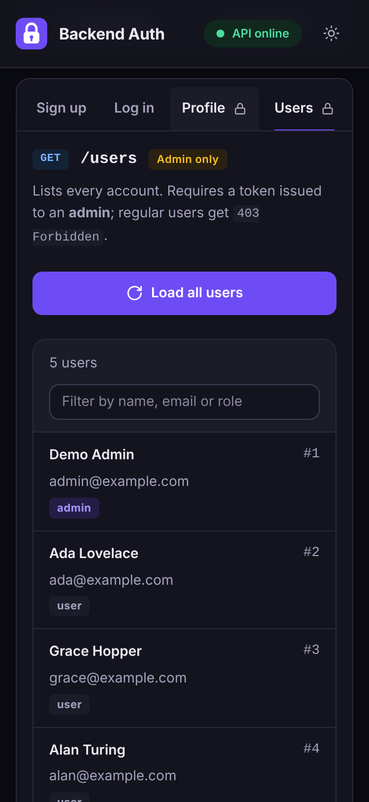
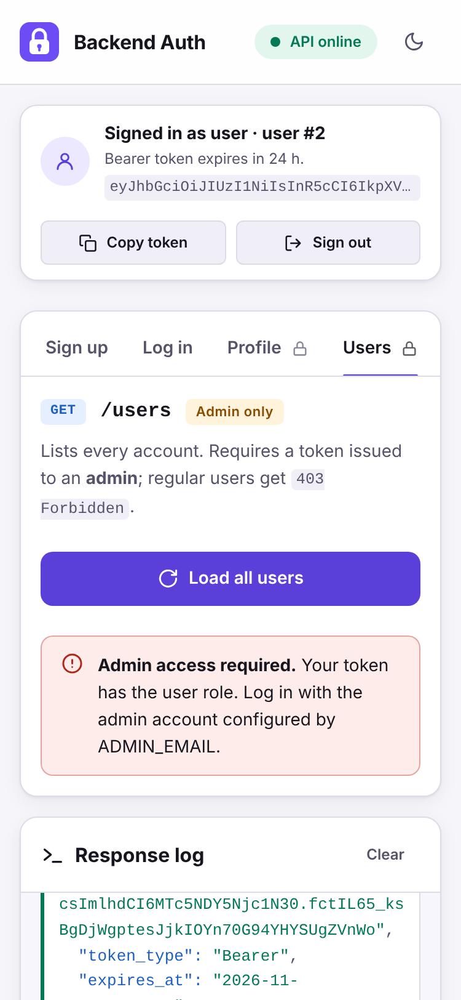
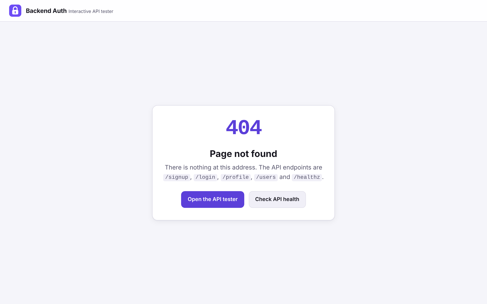
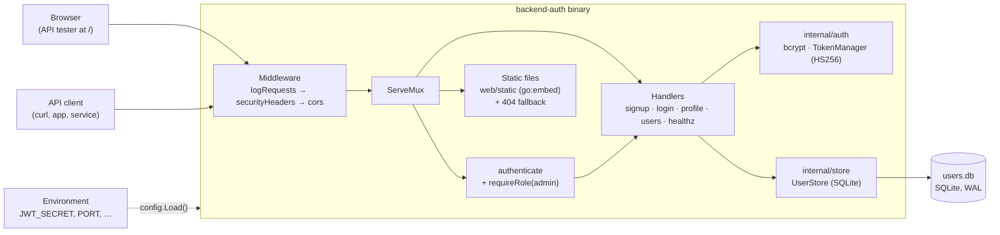
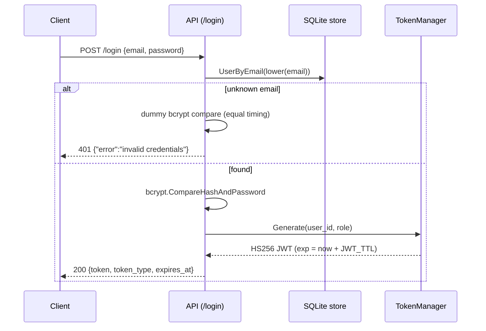

# Backend Auth Service

**A small, self-contained authentication API in Go: signup, bcrypt password hashing, JWT login and role-based access control on SQLite. It ships with a polished browser tester inside the same binary.**




---

## Contents

- [Overview](#overview)
- [Screenshots](#screenshots)
- [Features](#features)
- [Tech stack](#tech-stack)
- [Architecture](#architecture)
- [Project structure](#project-structure)
- [Getting started](#getting-started)
- [Configuration](#configuration)
- [Running in development and production](#running-in-development-and-production)
- [Using the API tester](#using-the-api-tester)
- [API reference](#api-reference)
- [Scripts and commands](#scripts-and-commands)
- [Testing](#testing)
- [Linting and formatting](#linting-and-formatting)
- [Deployment](#deployment)
- [Troubleshooting and FAQ](#troubleshooting-and-faq)
- [Known limitations](#known-limitations)
- [Roadmap ideas](#roadmap-ideas)
- [Contributing](#contributing)
- [License](#license)

---

## Overview

Most apps need the same few auth pieces: register a user, store the password safely, issue a token at login, and gate some endpoints by role. Getting the details right is easy to skip: signing-key handling, timing leaks, privilege escalation through signup, input limits.

This project implements those pieces with a small dependency footprint (the Go standard library plus three modules), and treats security defaults as part of the job. It suits:

- **Learners and reviewers** who want a readable reference for JWT + bcrypt auth in idiomatic Go.
- **Prototype backends** that need working auth on a single instance without running a separate identity provider.
- **API consumers** who want to try every endpoint from a browser instead of hand-writing curl commands.

The service is one binary. It serves the JSON API and an embedded single-page tester at `/`. Its only state is a SQLite file.

## Screenshots

All screenshots were captured from the running app using demo accounts on `example.com`.

| Inline validation (desktop, light) | Admin user list (desktop, dark) |
| --- | --- |
|  |  |

| Profile (phone, light) | User list (phone, dark) | Non-admin gets 403 (phone, light) |
| --- | --- | --- |
|  |  |  |

<details>
<summary>404 page</summary>



</details>

## Features

**Authentication and authorisation**

- **Signup** with validation: name (1–100 characters), email (normalised to lower case, must be a bare address with a dot in the domain), password (8–72 bytes, bcrypt's limit). Duplicate emails are rejected case-insensitively with `409 Conflict`.
- **bcrypt password hashing** (`golang.org/x/crypto/bcrypt`). Logins for unknown emails run a dummy bcrypt comparison, so response time doesn't reveal which emails are registered.
- **JWT access tokens** (HS256) signed with `JWT_SECRET`. Lifetime is configurable. Verification accepts HS256 only and requires an expiry, so `alg: none` and algorithm-swap tokens are rejected.
- **Role-based access control** with two roles, `user` and `admin`. Self-service signup can only create `user` accounts; asking for any other role returns `403`. Admins come from a bootstrap account set through environment variables.

**Operational defaults**

- 1 MiB request body cap, one JSON object per request, and server read/write/idle timeouts.
- Graceful shutdown on `SIGINT`/`SIGTERM`, structured logging with `log/slog` (one line per request), and panic recovery.
- Security headers on every response: a strict `Content-Security-Policy` (no inline scripts or styles), `X-Content-Type-Options: nosniff`, `X-Frame-Options: DENY` and `Referrer-Policy: no-referrer`.
- Opt-in CORS allow-list (`CORS_ALLOWED_ORIGINS`), off by default.
- `GET /healthz`, which also pings the database.
- Unknown paths return a styled 404 page to browsers and `{"error":"not found"}` to API clients.

**Embedded API tester** (`web/static`, served at `/`)

- Sign up, log in, load your profile and list users (admin) through real forms. Enter submits.
- Inline validation that mirrors the server rules, a show/hide password toggle, and plain-language error messages, such as *"Wrong email or password"* or *"Admin access required"*.
- A session card that decodes the JWT to show role, user ID and time to expiry, with **Copy token** and **Sign out** buttons. The token is kept in `sessionStorage`, so it lasts for the browser tab only.
- Loading skeletons plus empty, error and success states for every request. The user table can be filtered and stacks into cards on phones.
- A response log showing the method, path, status text, timing and syntax-highlighted JSON. All server data is escaped before display.
- A live API health indicator, and a light/dark theme that follows the OS with a manual toggle.
- Accessibility: semantic landmarks, a skip link, labelled fields with `aria-invalid` and `aria-describedby`, ARIA tabs (arrow keys, Home and End), visible focus rings, 44 px touch targets, `prefers-reduced-motion` support and AA colour contrast.
- No build step, no framework and no external requests: plain HTML, CSS and JavaScript embedded with `go:embed`.

## Tech stack

| Concern           | Choice                                                         |
| ----------------- | -------------------------------------------------------------- |
| Language          | Go 1.26                                                        |
| HTTP              | `net/http` standard library with the method-aware `ServeMux`   |
| Database          | SQLite through `github.com/mattn/go-sqlite3` v1.14 (cgo), WAL mode |
| Tokens            | `github.com/golang-jwt/jwt/v5`                                 |
| Password hashing  | `golang.org/x/crypto/bcrypt`                                   |
| Logging           | `log/slog` (text handler on stdout)                            |
| Frontend          | Vanilla HTML, CSS and JavaScript, embedded with `go:embed`     |
| Lint and format   | golangci-lint v2 (gofmt, goimports, gosec, revive, errorlint and more) |
| Container         | Multi-stage Docker build on `gcr.io/distroless/base-debian12:nonroot` |
| CI                | GitHub Actions (`.github/workflows/ci.yml`)                    |

## Architecture



**Request lifecycle**

1. `logRequests` records method, path, status and duration, and turns a handler panic into a `500` JSON error.
2. `securityHeaders` adds CSP, `nosniff`, frame denial and referrer policy.
3. `cors` adds CORS headers only for allow-listed origins, and answers preflight requests with `204`.
4. The `ServeMux` routes by method and path. `/profile` is wrapped in `authenticate`. `/users` is wrapped in `authenticate` and then `requireRole("admin")`.
5. Handlers decode JSON (1 MiB cap), validate, call `internal/auth` and `internal/store`, and write JSON responses.

**Login sequence**



**Design notes**

- `main.go` loads config, opens the store, seeds the optional admin, starts the server and shuts it down cleanly.
- Handlers depend on a small `UserStore` interface and a `*auth.TokenManager`. There is no global state, so the HTTP tests run against a real temporary database with `httptest`.
- The tester is a static page that uses the same public API as any other client. It has no private endpoints.

## Project structure

```text
.
├── main.go                     # Entry point: config, store, admin seed, HTTP server, graceful shutdown
├── internal/
│   ├── api/
│   │   ├── server.go           # Routes, static file serving with 404 fallback
│   │   ├── handlers.go         # signup, login, profile, users, healthz
│   │   ├── middleware.go       # authenticate, requireRole, CORS, security headers, logging/recovery
│   │   ├── validate.go         # Email/name/password rules
│   │   ├── respond.go          # JSON helpers, 1 MiB body cap
│   │   ├── bootstrap.go        # EnsureAdmin: creates the bootstrap admin on startup
│   │   └── api_test.go         # End-to-end HTTP tests against a temp SQLite DB
│   ├── auth/
│   │   ├── password.go         # bcrypt hash/check, 72-byte limit, timing equaliser
│   │   ├── token.go            # TokenManager: HS256 issue/verify with typed claims
│   │   └── auth_test.go
│   ├── config/
│   │   ├── config.go           # Environment parsing and validation
│   │   └── config_test.go
│   └── store/
│       ├── store.go            # SQLite users repository (WAL, busy timeout, NOCASE emails)
│       └── store_test.go
├── web/
│   ├── web.go                  # go:embed of web/static
│   └── static/
│       ├── index.html          # API tester markup (SVG icon sprite inline)
│       ├── app.css             # Design tokens, light/dark themes, components
│       ├── app.js              # Tester logic: forms, validation, session, log
│       ├── theme.js            # Applies the saved theme before first paint
│       ├── 404.html            # Not-found page
│       └── favicon.svg
├── docs/screenshots/           # README screenshots captured from the running app
├── .github/workflows/ci.yml    # Tidy check, lint, race tests, build, govulncheck, Docker build
├── .golangci.yml               # golangci-lint v2 configuration
├── .env.example                # Every supported environment variable, documented
├── Dockerfile                  # Multi-stage build → distroless, non-root
├── Makefile                    # run, build, test, lint, fmt, vuln
├── go.mod / go.sum
└── README.md
```

## Getting started

### Prerequisites

| Tool | Version | Why |
| --- | --- | --- |
| Go | 1.26 or newer | `go.mod` targets `go 1.26.0` (required by `golang.org/x/crypto` v0.59) |
| C toolchain | gcc or clang | `go-sqlite3` uses cgo. On Debian/Ubuntu run `apt install build-essential`; on macOS run `xcode-select --install` |
| OpenSSL | any | Only to generate a random `JWT_SECRET`; any 32+ byte random string works |
| golangci-lint | v2, built with Go 1.26+ | Optional, for `make lint` |
| Docker | any recent | Optional, for container builds |

### Installation

```bash
# 1. Clone
git clone https://github.com/jeevithg090/Task-Job.git
cd Task-Job

# 2. Download dependencies
go mod download

# 3. Configure (the server reads the process environment; it does not load .env files)
export JWT_SECRET="$(openssl rand -base64 48)"
export ADMIN_EMAIL=admin@example.com        # optional: creates an admin on first start
export ADMIN_PASSWORD='change-me-please'    # required if ADMIN_EMAIL is set

# 4. Run
go run .
```

You should see:

```text
level=INFO msg="created bootstrap admin account" user_id=1
level=INFO msg="server listening" addr=http://localhost:8080
```

Open <http://localhost:8080> to use the tester, or call the API with curl as shown in [API reference](#api-reference).

> **Tip:** to keep settings in a file, copy `.env.example` to `.env`, fill it in, and load it into your shell with `set -a; source .env; set +a` before `go run .`.

## Configuration

All configuration comes from environment variables. Blank values count as unset. Invalid values stop the server at startup with a clear error.

| Variable | Required | Default | Description |
| --- | --- | --- | --- |
| `JWT_SECRET` | **yes** | — | HMAC-SHA256 signing key, **at least 32 bytes**. The server refuses to start without it. Changing it invalidates every issued token. Generate one with `openssl rand -base64 48`. |
| `PORT` | no | `8080` | TCP port to listen on (0–65535). |
| `DATABASE_PATH` | no | `./users.db` | SQLite file path. Created if missing. WAL mode adds `-wal` and `-shm` files next to it. |
| `JWT_TTL` | no | `24h` | Token lifetime as a positive Go duration, such as `30m`, `12h` or `168h`. |
| `CORS_ALLOWED_ORIGINS` | no | *(empty)* | Comma-separated origins allowed to call the API from another origin, such as `https://app.example.com,http://localhost:5173`. Empty means same-origin only; `*` allows any origin. |
| `ADMIN_EMAIL` | no | *(empty)* | If set, an `admin` account with this email is created at startup unless the email is already registered. An existing account is never modified. |
| `ADMIN_PASSWORD` | if `ADMIN_EMAIL` is set | — | Password for the bootstrap admin. Same rules as signup: 8–72 bytes. |
| `ADMIN_NAME` | no | `Administrator` | Display name for the bootstrap admin. |

## Running in development and production

**Development**

```bash
export JWT_SECRET="$(openssl rand -base64 48)"
make run            # same as: go run .
```

The tester's HTML, CSS and JavaScript are embedded at compile time, so restart `go run .` after editing files in `web/static`.

**Production binary**

```bash
make build          # CGO_ENABLED=1 go build -trimpath -ldflags="-s -w" -o bin/backend-auth .
JWT_SECRET=... DATABASE_PATH=/var/lib/backend-auth/users.db ./bin/backend-auth
```

**Production container**: see [Deployment](#deployment).

## Using the API tester

1. **Sign up.** Fill in name, email and password and press Enter or **Create account**. Invalid fields are flagged inline before any request is sent. On success, **Continue to log in** pre-fills the login form.
2. **Log in.** On success the session card shows your role, user ID, time to expiry and the token, with **Copy token** and **Sign out**. Wrong credentials show *"Wrong email or password"*.
3. **Profile.** **Load my profile** calls `GET /profile` with your token and renders a profile card.
4. **Users.** Log in with the bootstrap admin and press **Load all users** to get a filterable table. A regular user gets a clear *"Admin access required"* message, so you can see the `403` behaviour.
5. **Response log.** Every request appears on the right (below the forms on phones) with its status, timing and raw JSON. **Clear** empties the log.

Other details: the theme toggle in the header switches light and dark mode and remembers your choice. The health pill shows whether `/healthz` responds. Tabs can be linked directly, as in `/#login` or `/#users`.

## API reference

Every API response is JSON (`Content-Type: application/json; charset=utf-8`). Errors always look like `{"error": "message"}`.

| Method | Path       | Auth                 | Description                                       | Success |
| ------ | ---------- | -------------------- | ------------------------------------------------- | ------- |
| POST   | `/signup`  | —                    | Register a `user` account                         | `201`   |
| POST   | `/login`   | —                    | Exchange email and password for a JWT             | `200`   |
| GET    | `/profile` | Bearer token         | The authenticated user's profile                  | `200`   |
| GET    | `/users`   | Bearer token, admin  | List all users ordered by ID                      | `200`   |
| GET    | `/healthz` | —                    | Liveness check that also pings the database       | `200` / `503` |
| GET    | `/`        | —                    | The embedded API tester (static files)            | `200`   |

Send tokens as `Authorization: Bearer <token>`. The scheme name is case-insensitive.

### `POST /signup`

```bash
curl -i -X POST http://localhost:8080/signup \
  -H 'Content-Type: application/json' \
  -d '{"name":"Ada Lovelace","email":"ada@example.com","password":"password123"}'
```

```json
HTTP/1.1 201 Created

{"message":"user created","user":{"id":2,"name":"Ada Lovelace","email":"ada@example.com","role":"user"}}
```

Errors:

```json
400 {"error":"password must be at least 8 characters"}
403 {"error":"only the user role can be self-registered"}   // body contained "role":"admin"
409 {"error":"email already registered"}
```

### `POST /login`

```bash
curl -X POST http://localhost:8080/login \
  -H 'Content-Type: application/json' \
  -d '{"email":"ada@example.com","password":"password123"}'
```

```json
{"token":"eyJhbGciOiJIUzI1NiIsInR5cCI6IkpXVCJ9…","token_type":"Bearer","expires_at":"2026-11-15T22:54:03Z"}
```

The token payload contains `user_id`, `role`, `sub` (the user ID as a string), `iat` and `exp`. A wrong password or unknown email returns `401 {"error":"invalid credentials"}`.

### `GET /profile`

```bash
TOKEN=$(curl -s -X POST http://localhost:8080/login -H 'Content-Type: application/json' \
  -d '{"email":"ada@example.com","password":"password123"}' | sed -E 's/.*"token":"([^"]+)".*/\1/')

curl http://localhost:8080/profile -H "Authorization: Bearer $TOKEN"
```

```json
{"id":2,"name":"Ada Lovelace","email":"ada@example.com","role":"user"}
```

### `GET /users` (admin)

```bash
curl http://localhost:8080/users -H "Authorization: Bearer $ADMIN_TOKEN"
```

```json
[
  {"id":1,"name":"Demo Admin","email":"admin@example.com","role":"admin"},
  {"id":2,"name":"Ada Lovelace","email":"ada@example.com","role":"user"}
]
```

With a `user` token: `403 {"error":"forbidden: admin access required"}`. An empty table returns `[]`.

### `GET /healthz`

```json
{"status":"ok"}            // 200
{"status":"unavailable"}   // 503 when the database ping fails (2 s timeout)
```

### Status codes

| Code | When |
| ---- | ---- |
| 400 | Malformed JSON, more than one JSON value, body over 1 MiB, missing or invalid fields |
| 401 | Bad credentials, or a missing, malformed, invalid or expired token |
| 403 | Non-admin calling `/users`, or signup asking for a non-`user` role |
| 404 | Unknown path (HTML page for browsers, JSON for API clients), or a profile for a deleted user |
| 405 | Wrong method on an API route, such as `GET /signup` (includes an `Allow` header) |
| 409 | Email already registered |
| 500 | Unexpected server error (details are logged, never returned) |
| 503 | `/healthz` when the database is unreachable |

## Scripts and commands

| Command | What it does |
| --- | --- |
| `make run` | `go run .`: start the server (needs `JWT_SECRET`) |
| `make build` | Build an optimised binary at `bin/backend-auth` (cgo enabled, stripped) |
| `make test` | `go test -race -count=1 ./...` |
| `make lint` | `golangci-lint run ./...` |
| `make fmt` | `golangci-lint fmt ./...` (gofmt + goimports) |
| `make vuln` | Run `govulncheck` against the module |
| `go test -cover ./...` | Tests with per-package coverage |
| `go mod tidy -diff` | Check `go.mod`/`go.sum` are tidy (CI runs this) |
| `docker build -t backend-auth .` | Build the production image |

## Testing

```bash
make test                 # race detector on, no cache
go test -cover ./...      # coverage per package
go test -run TestLoginFailures -v ./internal/api   # a single test
```

What's covered (measured with `go test -cover` on this branch):

| Package | Coverage | Highlights |
| --- | --- | --- |
| `internal/api` | 83.0% | Signup validation and role rejection, duplicate emails (case-insensitive), login success and failure, profile and admin-only listing, malformed and oversized bodies, `405` handling, CORS preflight allow/deny, health check, static files, the 404 page vs JSON 404, and that the CSP forbids inline code |
| `internal/auth` | 85.7% | bcrypt round trip and the 72-byte limit, token issue/verify, expired tokens, tampering, wrong key, `alg: none`, algorithm swap, missing expiry |
| `internal/config` | 96.2% | Defaults, required `JWT_SECRET` and minimum length, port and TTL validation, CORS parsing, admin seed rules |
| `internal/store` | 73.9% | Create and lookup, case-insensitive uniqueness, `ErrNotFound`, ordered listing |

The browser tester has no automated test suite in the repo. It was checked by hand and with headless Chromium at 375 px, 768 px and 1280 px in both themes: every flow, keyboard tab navigation, no horizontal scrolling and no script errors.

## Linting and formatting

The project uses **golangci-lint v2** with the configuration in [`.golangci.yml`](.golangci.yml): the `standard` set plus `bodyclose`, `errorlint`, `gosec`, `misspell` (UK spelling), `noctx`, `revive` (exported docs, package comments), `unconvert` and `unparam`; formatters are `gofmt` and `goimports` with `backend-auth` as the local import prefix.

```bash
make lint
make fmt
```

golangci-lint must be built with Go 1.26 or newer, or it refuses to load the config. If your installed binary is older, install one with `go install github.com/golangci/golangci-lint/v2/cmd/golangci-lint@latest`.

## Deployment

The service is a single binary that serves both the API and the tester. Its only state is the SQLite file, so deployment means running one container (or process) with a persistent volume and a secret.

### Docker

```bash
docker build -t backend-auth .

docker run -d --name backend-auth -p 8080:8080 \
  -e JWT_SECRET="$(openssl rand -base64 48)" \
  -e ADMIN_EMAIL=admin@example.com \
  -e ADMIN_PASSWORD='change-me-please' \
  -v backend-auth-data:/data \
  backend-auth
```

- The image is built on `golang:1.26-bookworm` (with cgo) and runs on `gcr.io/distroless/base-debian12:nonroot` as a non-root user.
- `DATABASE_PATH` defaults to `/data/users.db` inside the image. Mount a volume at `/data` to keep data across restarts.
- Only port `8080` is exposed. Override `PORT` if you need another.

### Continuous integration

`.github/workflows/ci.yml` runs on pull requests and pushes to `main`. It checks that `go.mod` is tidy, then runs golangci-lint, the race-enabled tests with coverage, the build and `govulncheck`, and builds the Docker image in a separate job. It does not deploy anything.

### Production checklist

- Generate a fresh `JWT_SECRET` per environment and keep it in your platform's secret store, never in the repo. Rotating it signs everyone out.
- Terminate TLS in front of the service (reverse proxy or load balancer). Bearer tokens must never travel over plain HTTP.
- Point liveness and readiness probes at `GET /healthz`.
- Back up the volume holding `users.db` (and its `-wal`/`-shm` files), or use the SQLite online backup API.
- Run **one** instance. SQLite in WAL mode with a 5 s busy timeout is fine for a single writer; for several replicas, move to a networked database.
- If a browser app on another origin calls the API, set `CORS_ALLOWED_ORIGINS` to its exact origin instead of `*`.
- Logs go to stdout in `slog` text format. Ship them with your platform's log collector.

## Troubleshooting and FAQ

**The server exits with `JWT_SECRET is required` or `JWT_SECRET must be at least 32 bytes`.**
Set a secret of at least 32 bytes: `export JWT_SECRET="$(openssl rand -base64 48)"`. The server does not read `.env` files on its own; export the variables or `source` the file first.

**Build fails with `cgo: C compiler "gcc" not found` or `undefined: sqlite3...`.**
`go-sqlite3` needs cgo. Install a C toolchain and make sure `CGO_ENABLED=1` (the default when a compiler is present).

**`go: go.mod requires go >= 1.26.0`.**
Upgrade Go, or let the Go toolchain download it automatically (`GOTOOLCHAIN=auto`, the default).

**golangci-lint says `the Go language version (go1.25) used to build golangci-lint is lower than the targeted Go version`.**
Reinstall golangci-lint with Go 1.26+ (see [Linting and formatting](#linting-and-formatting)).

**`ADMIN_PASSWORD is required when ADMIN_EMAIL is set` or `invalid admin seed: …`.**
Provide an admin password of 8–72 bytes and a valid email address.

**I changed `ADMIN_PASSWORD` but the old password still works.**
The bootstrap admin is created only if the email isn't registered yet; an existing account is never modified. Delete the row (or the database) or use a new email.

**I logged in but `/users` returns 403.**
Only `admin` tokens can list users, and signup always creates `user` accounts. Log in with the `ADMIN_EMAIL` account.

**My token stopped working after a restart.**
Either it expired (`JWT_TTL`) or `JWT_SECRET` changed. Generating a new secret on every start, as the quick-start snippet does, signs everyone out. Keep the secret stable to keep sessions valid.

**A browser app on another port gets CORS errors.**
Add its origin to `CORS_ALLOWED_ORIGINS`, for example `http://localhost:5173`.

**`database is locked` errors.**
Usually several processes share the same file. Run one instance per database file.

**I edited `web/static` and nothing changed.**
Files are embedded at build time. Restart `go run .` or rebuild the binary, then hard-refresh the browser.

## Known limitations

- **Single instance only.** SQLite on local disk; no clustering.
- **No token revocation or refresh tokens.** Logging out in the tester only forgets the token client-side; a token stays valid until it expires or `JWT_SECRET` rotates.
- **No rate limiting** on `/login` or `/signup`. Put a proxy limit in front of public deployments.
- **No email verification, password reset, or account update/delete endpoints.**
- **Admins can only be created through the bootstrap variables**; there is no API to promote users.
- The tester is for development and demos. It keeps the token in `sessionStorage`, which is acceptable for a test tool but not a pattern for production frontends.

## Roadmap ideas

- Rate limiting and lockout for repeated failed logins
- Refresh tokens with rotation, plus a revocation list
- Password reset and email verification flows
- Admin endpoints to change roles and deactivate users
- Optional Postgres backend behind the existing `UserStore` interface
- OpenAPI spec generated from the handlers
- Playwright smoke tests for the tester in CI

## Contributing

1. Fork the repository and create a branch: `git checkout -b feat/short-description`.
2. Make your change with tests. Keep handlers depending on interfaces, not concrete types.
3. Run `make fmt`, `make lint`, `make test` and `go mod tidy -diff` locally. CI runs the same checks.
4. For UI changes, check the tester at phone (~375 px) and desktop widths in both themes, and keep server data out of `innerHTML` unless it is escaped.
5. Use [Conventional Commits](https://www.conventionalcommits.org/) (`feat:`, `fix:`, `docs:`, `test:`, `refactor:`, `chore:`), then open a pull request describing what changed and how you verified it.

Please report security issues privately to the repository owner rather than in a public issue.

## License

This repository has no license file yet, so all rights are reserved by default and others may not reuse the code. If you want it to be open source, add a `LICENSE` file. **MIT** (short and permissive) or **Apache-2.0** (permissive with an explicit patent grant) are common choices for a project like this.
